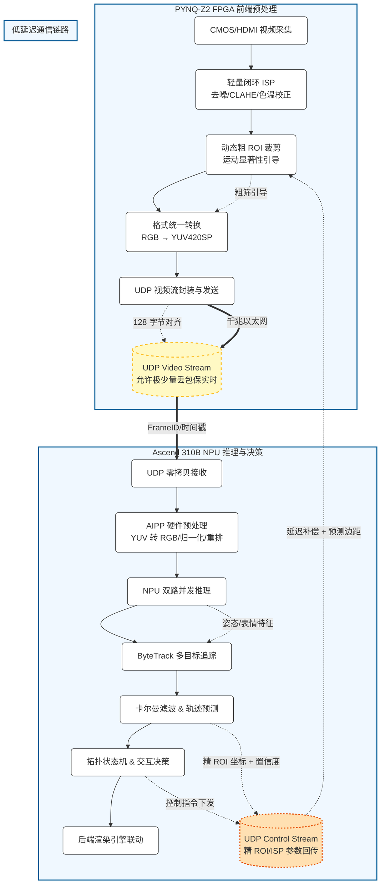

# 集创赛 - 华强 X 昇腾智能视觉交互系统报告

## 一、简介

本项目是参加全国大学生集成电路创新创业大赛（集创赛）的参赛作品，基于华为昇腾 Ascend 310B NPU 与 PYNQ-Z2 FPGA 构建的异构视觉交互终端系统。系统面向主题乐园、展演场馆等开放场景，实现游客动作识别、表情捕捉与卡通熊 IP 沉浸式演艺联动功能。

### 1.1 项目名称

**华强 X 昇腾 - 智能视觉交互终端**

### 1.2 参赛赛道

全国大学生集成电路创新创业大赛 - 华为昇腾命题赛道

### 1.3 技术栈

- **前端预处理**：PYNQ-Z2 FPGA (Xilinx Zynq-7020) + HLS 高层次综合
- **核心推理**：华为昇腾 Ascend 310B NPU + CANN 7.0
- **通信协议**：自定义 UDP 视频流分片协议（千兆以太网）
- **算法框架**：YOLOv26s-Pose 姿态估计 + ByteTrack 多目标追踪 + 表情分类网络
- **开发环境**：Ubuntu 22.04 + Vitis 2025.2 + CMake + OpenCV 4.4

---

## 二、项目背景和目标

### 2.1 赛题背景

随着文旅产业的数字化转型，主题乐园和展演场所对智能化、沉浸式互动体验的需求日益增长。传统的人工表演或预设程序无法实现与游客的实时双向互动，而基于计算机视觉的智能交互系统能够感知游客的动作和表情，触发相应的虚拟形象回应、剧情分支切换或 AR 特效，极大提升游客参与感和满意度。
本赛题要求参赛队伍基于华为昇腾 310B/310P 芯片或"310B+FPGA"异构平台，完成视频图像的采集与处理，构建具备以下能力的智能视觉交互终端：

1. **动作识别**：准确识别挥手、欢呼、比心等常见互动动作
2. **表情捕捉**：实时捕捉游客微笑、惊讶、开心等表情变化
3. **IP 联动**：稳定联动至少 3 种卡通熊 IP 主题演艺形式
4. **场景适配**：适应乐园开放环境的光照变化、人群密集、动态障碍物等复杂场景

### 2.2 项目目标

#### 2.2.1 总体目标

基于 PYNQ-Z2 (FPGA) + Ascend 310B (NPU) 构建异构视觉交互终端，面向园区/展演场景实现：

- **动作识别**（挥手/比心/欢呼）
- **表情捕捉与识别**
- **多目标管理与交互决策**
- **IP 联动演艺**（预生成视频触发）
- **前后端联动控制**（优先 UDP）

#### 2.2.2 技术指标

| 指标类别 | 具体指标 | 目标值 |
|---------|---------|--------|
| 动作识别 | 挥手/欢呼/比心准确率 | > 90% |
| 表情捕捉 | 表情响应延迟 | < 100ms |
| IP 联动 | 支持 IP 主题数量 | ≥ 3 种 |
| 系统性能 | 端到端时延 | < 100ms |
| 场景适应性 | 光照变化鲁棒性 | 支持 |
| 并发能力 | 多目标追踪数量 | ≥ 5 人 |

#### 2.2.3 阶段目标

**当前阶段（2026-04）**：完成姿态识别闭环，扩展表情分支，实现 IP 视频联动。

---

## 三、系统架构

### 3.1 顶层架构设计

为满足低延迟与高吞吐量的要求，系统摒弃传统的"CPU 大包大揽"模式，构建高度流水线化的异构数据通路。整体架构划分为四个层级：

```
┌─────────────────────────────────────────────────────────────────┐
│                        感知输入层                                │
│                    USB/CMOS 摄像头采集                            │
│                    HDMI/MIPI 接口可选                            │
└─────────────────────────────────────────────────────────────────┘
                              │
                              ▼
┌─────────────────────────────────────────────────────────────────┐
│                      图像预处理层 (PYNQ-Z2 FPGA)                │
│  ┌─────────────┐  ┌─────────────┐  ┌─────────────────────────┐ │
│  │  ROI 选择   │→ │  ISP 处理   │→ │  RGB2YUV420SP 输出      │ │
│  │  (动态配置) │  │(白平衡/Gamma)│  │    (至 310B DVPP)      │ │
│  │             │  │  + 降噪     │  │                         │ │
│  └─────────────┘  └─────────────┘  └─────────────────────────┘ │
└─────────────────────────────────────────────────────────────────┘
                              │
                              ▼
┌─────────────────────────────────────────────────────────────────┐
│                      核心推理层 (Ascend 310B NPU)               │
│  ┌─────────────┐  ┌─────────────┐  ┌─────────────────────────┐ │
│  │   DVPP      │→ │    AIPP     │→ │      NPU 推理           │ │
│  │ (缩放/裁剪) │  │(归一化/转换)│  │  (动作识别/表情捕捉)    │ │
│  └─────────────┘  └─────────────┘  └─────────────────────────┘ │
│  ┌─────────────────────────────────────────────────────────┐   │
│  │              决策引擎 & 多目标追踪                       │   │
│  │         (ByteTrack + 卡尔曼滤波 + 拓扑状态机)            │   │
│  └─────────────────────────────────────────────────────────┘   │
└─────────────────────────────────────────────────────────────────┘
                              │
                              ▼
┌─────────────────────────────────────────────────────────────────┐
│                        沉浸表现层                                │
│    ┌─────────────────┐          ┌─────────────────────────┐    │
│    │  HDMI 本地直显   │          │ 网络化实时渲染 (UDP)    │    │
│    │  (基础交付路线)  │          │  (高阶进阶路线)         │    │
│    │  叠加 AI 识别框   │          │  虚幻引擎/Unity 渲染    │    │
│    │  骨骼关键点连线  │          │  卡通熊 IP 3D 资产       │    │
│    └─────────────────┘          └─────────────────────────┘    │
└─────────────────────────────────────────────────────────────────┘
```

### 3.2 硬件协同与底层加速策略

#### 3.2.1 软硬解耦，算力卸载

将传统的 CPU 图像预处理任务拆分给 DVPP 和 AIPP 两个底层硬件模块进行"接力"：
**1. DVPP（Digital Vision Pre-Processing）- 物理整形**

- **思路**：摒弃传统的 OpenCV 软解思路，直接调用 310B 独立的 DVPP 硬件单元
- **作用**：接收从 FPGA 传入的高清视频流后，纯靠硬件完成图像的缩放（Resize）、裁剪（Crop）或基础格式解码
- **优势**：将 CPU 从最耗时的像素搬运中彻底解放出来
**2. AIPP（AI Pre-Processing）- 数学转换**
- **思路**：利用 310B NPU 特有的 AIPP 机制，将像素级的数学运算提前"编译"进 AI 模型中
- **作用**：原本需要用代码遍历像素去做的色域转换（如 YUV 转 RGB）、减均值、归一化（/255）等操作，变成 NPU 推理前自动执行的底层指令
- **优势**：由于和模型推理深度融合，这部分预处理的时间损耗几乎可以忽略不计

#### 3.2.2 FPGA 前端预处理

PYNQ-Z2 FPGA 负责视频流的前端预处理，包括：

| 功能模块 | 描述 | 配置参数 |
|---------|------|---------|
| **ISP 处理** | 白平衡 + Gamma 校正 + 时域降噪 | `wb_r/g/b_gain`, `gamma_mode`, `denoise_strength` |
| **动态 ROI** | 像素级门控，仅 ROI 内执行 ISP | `roi_x/y/w/h` |
| **RGB2YUV** | RGB 到 YUV420SP (NV12) 转换，2x2 色度抽取 | 自动处理 |
| **格式适配** | 支持 RGB/BGR 输入切换 | `input_is_bgr` |

**优化策略**：

- DATAFLOW：三阶段任务级并行（ISP → ROI → RGB2YUV）
- SRL 线缓冲：2x2 色度平均，1 周期访问延迟
- DSP48 并行计算：YUV 转换加速，延迟降低 15-25%
- 零开销 ROI 检查：预计算边界，无分支预测惩罚

### 3.3 通信链路设计

通信采取 UDP 的方式进行传输，其目的是低延迟。系统采用自定义的 UDP 视频流分片协议，支持三端联调：PYNQ -> 310B -> PC。



#### 3.3.1 端口分配

| 端口 | 用途 | 方向 |
|------|------|------|
| 5555 | PC 监听端口 (PC_PORT) | 310B→PC 视频转发 |
| 9090 | PYNQ 监听端口 (PYNQ_PORT) | 310B→PYNQ 控制透传 |
| 5566 | 推理结果端口 | 310B→PC 姿态/表情推理结果 |
| 5567 | 视频控制端口 | 310B→PC IP 视频触发指令 |
| TBD | IP 视频触发端口 | PC→310B/PYNQ 视频触发 |

#### 3.3.2 网络地址配置

| 设备 | 接口 | IP 地址 | 用途 |
|------|------|---------|------|
| PC | eth0 | 192.168.137.1 | 与 310B 通信 |
| 310B | eth0 | 192.168.2.2 | 与 PYNQ 通信 |
| 310B | eth1 | 192.168.137.100 | 与 PC 通信 |
| PYNQ | eth0 | 192.168.2.99 | 与 310B 通信 |

### 3.4 核心算法栈

#### 3.4.1 动作识别：目标追踪与姿态估计

**技术路径**：避免使用易受背景干扰的全局图像分类法。采用"轻量级目标检测 (如 YOLOv8) + 骨骼关键点提取 (Pose Estimation)"的二维路线。
**当前实现**：

- 模型：YOLOv26s-Pose (已转换为 OM 格式)
- 动作判定逻辑：
  - 左手/右手腕部高于肩部判定
  - 双手上举判定为欢呼
  - 单手上举判定为挥手
- 输出协议：JSON 格式，包含 frame_id、timestamp_ms、kps_conf_mean、action_flag、action_conf

#### 3.4.2 表情捕捉：极限提速的两段式级联

**技术路径**：

1. 全局运行超轻量级人脸检测算法获取目标边界框
2. 利用 DVPP 抠出人脸 ROI 区域
3. 将低分辨率切图送入基于 MobileNet/ShuffleNet 骨干的表情分类网络

**待实现**：

- [ ] 人脸检测模型（OM 格式）
- [ ] DVPP ROI 处理与 AIPP 配置集成
- [ ] 表情分类网络（7 类基本表情）
- [ ] 多任务调度（姿态 + 表情并发推理）

#### 3.4.3 多目标追踪

- 算法：ByteTrack
- 轨迹预测：卡尔曼滤波
- 决策引擎：拓扑状态机 & 交互决策

### 3.5 IP 联动层

#### 3.5.1 实现方案

采用预生成视频方案（Coze 生成），待实现：

- [ ] 视频资产管理（3 种卡通熊 IP 主题）
- [ ] 触发逻辑引擎（动作/表情 → 视频 ID 映射）
- [ ] 视频播放控制（GStreamer/VLC 集成）
- [ ] 无缝切换机制（避免卡顿/黑屏）

#### 3.5.2 交互表现形式

1. **虚拟角色对话**：根据游客特定动作，触发不同的语音播报与口型同步动画
2. **剧情分支切换/动作互动**：游客的欢呼声量或挥手频率作为交互输入，推动大屏内不同剧情线的演进
3. **AR 合影特效**：提取游客骨骼与人脸坐标，实现虚拟道具（如熊大头饰、气球）与真实游客画面的精准三维贴合

#### 3.5.3 交互表现架构设计

**方向一：端侧本地直显（基础交付路线）**

- 实现逻辑：利用边缘计算盒子自带的硬件显示接口，直接将叠加了 AI 识别框、骨骼关键点连线或基础 2D 互动 UI 的处理结果，通过 HDMI 输出至本地显示设备
- 核心优势：架构精简，数据传输链路极短，能够实现极致的低延迟显示

**方向二：前后端解耦的网络化实时渲染（高阶进阶路线）**

- 实现逻辑：边缘端的 AI 进程仅作为纯粹的数据源，通过千兆以太网将结构化的判定结果推送至独立的后端业务分发服务。由后端统一下发控制指令，在前端大屏实时渲染卡通熊等 IP 的 3D 资产
- 核心优势：极大地丰富了沉浸式表现力，且将繁重的 UI 渲染任务从边缘 AI 推理芯片中彻底剥离；支持跨设备、多屏幕的分布式联动

---

## 四、当前进度（2026-04）

### 4.1 已完成

#### 4.1.1 310B 主工程

- ✅ 310B 主程序骨架已推进到可编译状态
- ✅ 已补齐并连通以下模块：
  - 310B 主程序骨架（`code/ascend_310b/src/main.cpp`）
  - 姿态 ROI 协议头（128B 对齐）
  - CMake 构建配置与 aarch64 工具链
  - 构建脚本与 Ascend 环境加载
  - AIPP 静态配置占位文件
- ✅ 已成功产出可执行文件：`ascend310b_pose`

#### 4.1.2 核心算法

- ✅ **姿态识别模型**：已集成 `yolo26s-pose.om`（位于 `code/ascend_310b/models/yolo26/`）
- ✅ **动作分类逻辑**：已实现基于骨骼关键点的动作判定（挥手/欢呼/未知）
  - 左手/右手腕部高于肩部判定
  - 双手上举判定为欢呼
  - 单手上举判定为挥手
- ✅ **UDP 通信**：完整的三端 UDP 链路（`code/communication/`）

#### 4.1.3 PYNQ HLS 工程

- ✅ 主工程：`hls/video_preprocess/`
- ✅ CSim：已通过（10/10 用例通过）
- ✅ C Synthesis：已完成并生成报告
- ✅ 关键综合指标：时钟估计 7.268 ns（目标 10 ns）
- ✅ 资源占用：BRAM 30 (10%)，DSP 14 (6%)，FF 7386 (6%)，LUT 7779 (14%)

#### 4.1.4 构建与部署

- ✅ 已修复关键构建问题（环境变量、头文件路径、库架构误链、协议头长度断言）
- ✅ 支持命令行参数配置（模型路径、绑定 IP、端口等）

### 4.2 待完成（下一阶段）

#### 4.2.1 高优先级 🔴

1. **表情捕捉模块**
   - [ ] 人脸检测模型（OM 格式）
   - [ ] DVPP ROI 处理与 AIPP 配置集成
   - [ ] 表情分类网络（7 类基本表情）
   - [ ] 多任务调度（姿态 + 表情并发推理）
2. **IP 视频联动**
   - [ ] 视频资产管理（3 种卡通熊 IP 主题）
   - [ ] 触发逻辑引擎（动作/表情 → 视频 ID 映射）
   - [ ] 视频播放控制（GStreamer/VLC 集成）
   - [ ] 无缝切换机制（避免卡顿/黑屏）
3. **端到端数据通路**
   - [ ] 推理结果到视频触发的闭环
   - [ ] 延迟补偿与预测边距
   - [ ] 多目标追踪与 ID 管理

#### 4.2.2 中优先级 🟡

4. **性能优化**
   - [ ] 端到端时延压测（目标：<100ms）
   - [ ] 动作识别准确率验证（目标：>90%）
   - [ ] 光照变化鲁棒性测试
   - [ ] 人群密集场景优化
5. **显示输出**
   - [ ] HDMI 本地直显确认
   - [ ] 网络化实时渲染架构对接

### 4.3 已知技术债务

- ⚠️ AIPP 配置仅为占位文件，需根据实际模型调整
- ⚠️ 错误处理与日志系统需完善
- ⚠️ 缺少单元测试与集成测试框架

### 4.4 里程碑状态

| 里程碑 | 状态 | 说明 |
|--------|------|------|
| M1 通信链路打通 | ✅ 已完成 | PYNQ -> 310B -> PC，含控制透传 |
| M2 310B 工程可编译 | ✅ 已完成 | 生成 ascend310b_pose |
| M3 单模型实流推理闭环 | 🔄 进行中 | 姿态识别闭环待联调 |
| M4 表情识别模块 | ⏳ 待开始 | 人脸检测 + 表情分类 |
| M5 IP 视频联动 | ⏳ 待开始 | 预生成视频触发 |
| M6 端到端时延与稳定性压测 | ⏳ 待开始 | 性能指标验证 |

---

## 五、未来发展方向

### 5.1 短期目标（1-2 个月）

#### 5.1.1 完成表情识别模块

- 集成人脸检测模型（RetinaFace/YOLO-Face）
- 实现表情分类网络（7 类基本表情：高兴、悲伤、愤怒、恐惧、惊讶、厌恶、中性）
- 完成姿态 + 表情多任务并发推理调度

#### 5.1.2 实现 IP 视频联动闭环

- 完成 3 种卡通熊 IP 主题视频资产制作
- 实现动作/表情到视频 ID 的映射逻辑引擎
- 集成 GStreamer/VLC 播放器，实现无缝切换

#### 5.1.3 端到端性能优化

- 端到端时延压测与优化（目标：<100ms）
- 动作识别准确率验证与提升（目标：>90%）
- 光照变化鲁棒性测试与优化
- 人群密集场景下的多目标追踪优化

### 5.2 中期目标（3-6 个月）

#### 5.2.1 多路视频融合输入

- 支持多路 CMOS/MIPI 摄像头并发输入
- 实现多路视频流的时空同步
- 支持广角 + 长焦双摄融合，提升远距离识别精度

#### 5.2.2 模型迭代升级

- 探索更轻量的姿态估计模型（如 MoveNet/LiteHRNet）
- 引入 Transformer 架构提升表情识别准确率
- 实现模型在线更新与热切换机制

#### 5.2.3 边缘 - 云协同

- 探索边缘推理 + 云端训练的协同架构
- 实现联邦学习，保护用户隐私的同时持续优化模型
- 支持远程运维与故障诊断

### 5.3 长期愿景

#### 5.3.1 产品化落地

- 封装为标准化的边缘计算盒子
- 提供 SDK 与 API，支持第三方开发者接入
- 拓展至更多场景：商场互动、博物馆导览、教育娱乐等

#### 5.3.2 生态建设

- 建立卡通熊 IP 内容创作平台，支持创作者上传自定义互动内容
- 构建开发者社区，分享最佳实践与技术文档
- 与主题乐园、文旅景区建立合作关系，推动规模化商用

#### 5.3.3 技术前沿探索

- 探索 3D 人体姿态估计与 SLAM 融合
- 研究多模态交互（视觉 + 语音 + 手势）
- 探索神经辐射场（NeRF）技术在沉浸式演艺中的应用

---

## 六、目录说明

```
/workspace/
├── README.md                 # 项目说明文档
├── docs/                     # 架构与方案文档
│   ├── 报告.md               # 本报告
│   └── 赛题.md               # 赛题需求详细说明
├── code/
│   ├── pynq_z2/              # PYNQ 侧 FPGA 工程（HLS 图像处理）
│   │   ├── hls/video_preprocess/  # 主工程 (ISP + ROI + RGB2YUV)
│   │   ├── ps/               # PS 侧 Python 脚本
│   │   └── pl/               # PL 比特流文件
│   ├── ascend_310b/          # 310B 推理与控制主工程
│   │   ├── src/              # 主程序（姿态识别完整实现）
│   │   ├── include/          # 协议头定义
│   │   ├── models/yolo26/    # YOLOv26s-Pose 模型（om/pt）
│   │   └── config/           # AIPP 配置文件
│   ├── communication/        # 三端 UDP 通信与中继
│   │   ├── src/              # pc_udp, 310B_udp, pynq_udp
│   │   └── include/          # UDP 共通定义
│   └── ip_player/            # [待创建] IP 视频播放控制
├── Scripts/                  # 环境与部署辅助脚本
│   ├── installation/         # 安装脚本
│   └── deployment/           # 部署脚本
└── NONE/                     # 其他目录
```

---

## 七、开发环境

- **操作系统**：Ubuntu 22.04 (WSL)
- **FPGA 工具链**：Vitis 2025.2
- **NPU 工具链**：CANN 7.0RC1 (板载预设)
- **NPU 监控**：npu-smi 23.0.rc3
- **图像处理**：OpenCV 4.4.0
- **构建系统**：CMake 3.22+
- **Python**：3.8+ (pybind11 绑定)
建议先执行仓库初始化脚本：

```bash
cd Scripts/installation
bash setup.sh
```

Vitis 依赖安装命令：

```bash
/opt/Xilinx/2025.2.1/Vitis/scripts/installLibs.sh
```

---

## 八、总结

本项目基于华为昇腾 Ascend 310B NPU 与 PYNQ-Z2 FPGA 构建了异构视觉交互终端系统，实现了动作识别、表情捕捉与 IP 沉浸式演艺联动功能。通过 FPGA 前端预处理、NPU 硬件加速推理、UDP 低延迟通信等技术手段，系统在保持高精度的同时实现了毫秒级的响应延迟。
当前项目已完成姿态识别闭环、三端 UDP 通信链路、PYNQ HLS 综合等核心功能，下一步将重点推进表情识别模块、IP 视频联动以及端到端性能优化。我们相信，通过持续的技术迭代与场景打磨，本系统能够为文旅产业提供更加智能、更加沉浸的互动体验解决方案。
