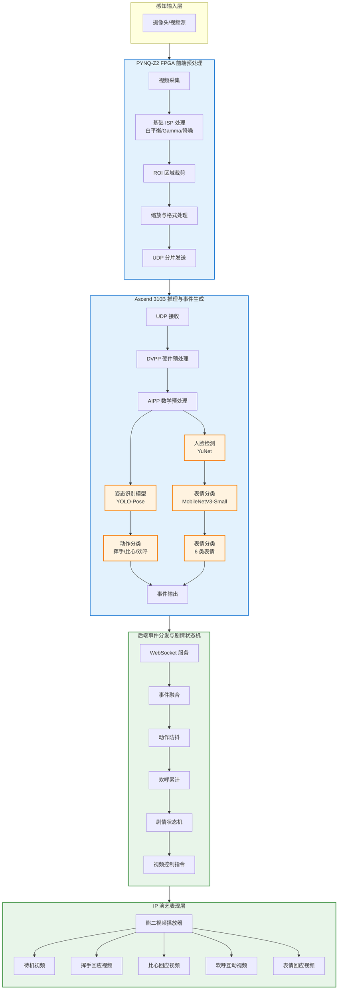
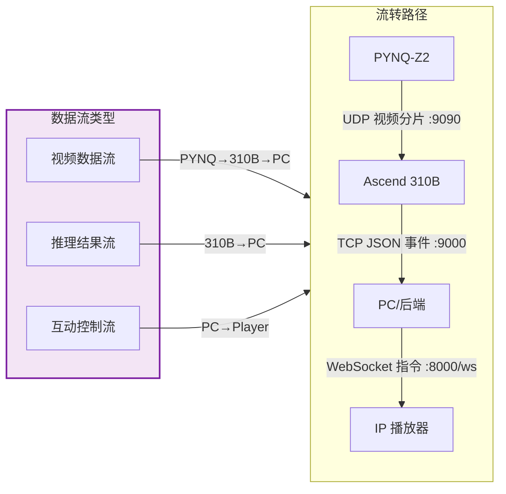
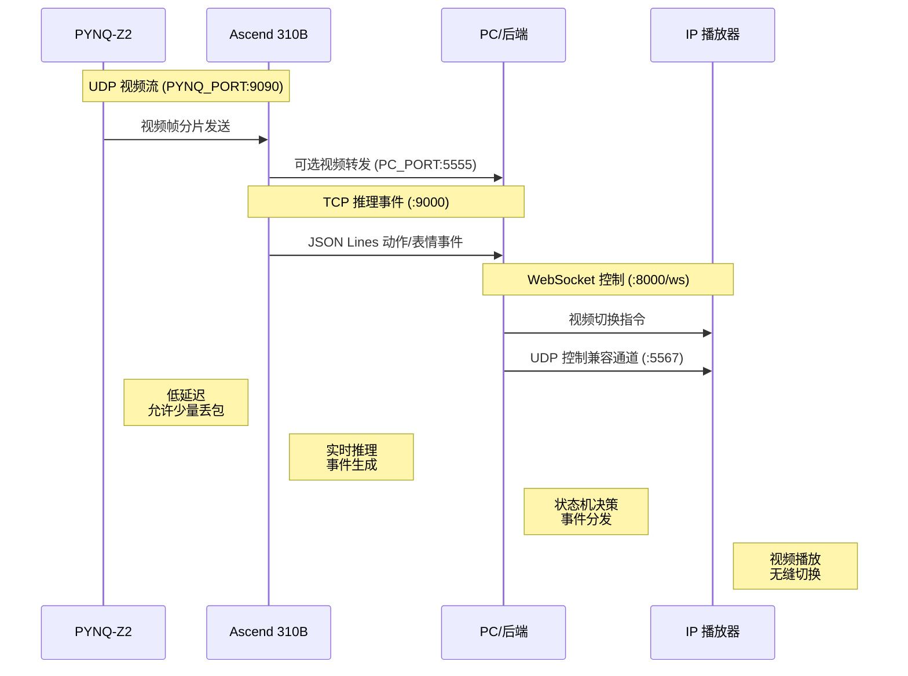
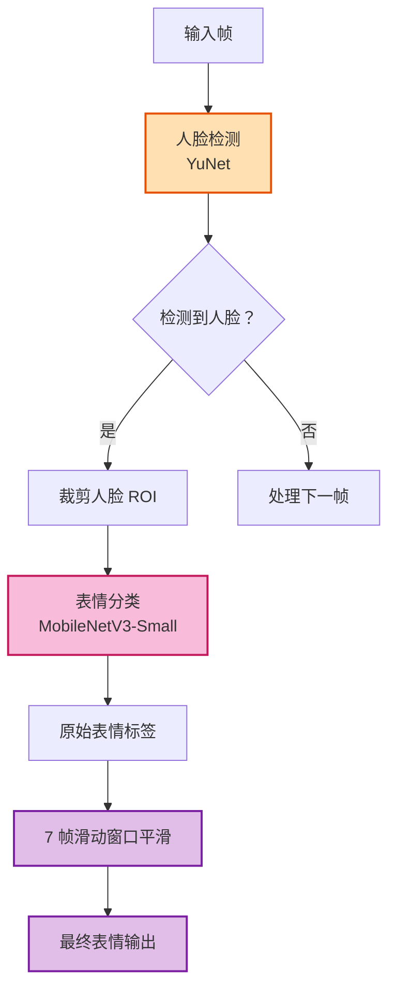
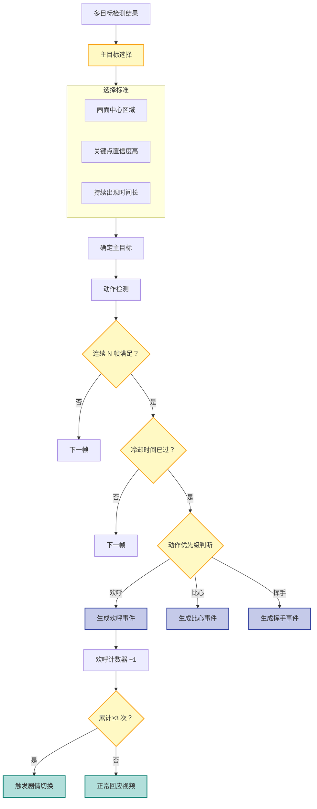
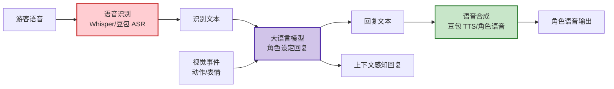
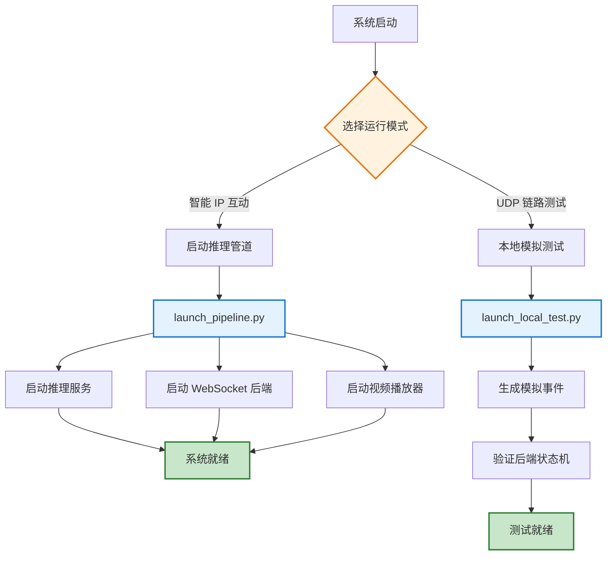
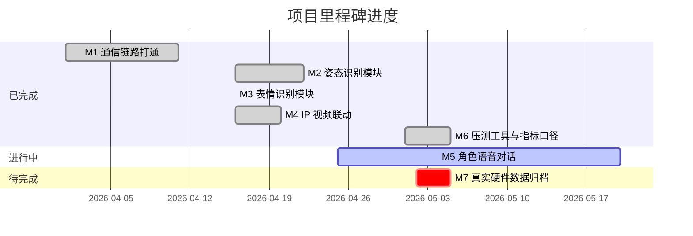
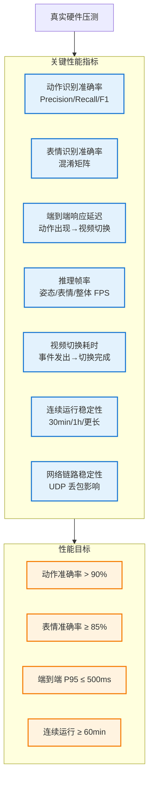

# 集创赛"华强 x 昇腾"智能视觉交互系统设计与实现报告

## 摘要

本项目面向全国大学生集成电路创新创业大赛"华强 x 昇腾"命题赛道，围绕主题乐园、展演场馆和互动大屏等开放式文旅场景，设计并实现了一套基于 **PYNQ-Z2 FPGA + 华为昇腾 Ascend 310B NPU** 的智能视觉交互终端系统。系统通过视频采集与预处理、端侧姿态识别、表情识别、多目标交互决策、后端事件分发和卡通熊 IP 视频联动，实现了"游客动作/表情输入—AI 推理判断—互动事件生成—IP 视频反馈"的完整闭环。

在硬件架构上，PYNQ-Z2 侧负责视频采集、基础 ISP、ROI、RGB/BGR 到 NV12 的格式整理和 UDP 分片发送；Ascend 310B 侧通过 `run_pipeline.py` 接收 UDP 视频流或本地视频源，优先使用 ONNX + OpenCV DNN/CANN 后端执行姿态识别与表情识别，在环境不满足时可回退到 CPU 或 PT/PTH 权重；PC/后端侧通过 TCP 与 WebSocket 完成互动事件分发，驱动熊二卡通形象视频播放与剧情状态切换。在算法实现上，系统采用 YOLO-Pose 完成挥手、比心、欢呼等动作识别，采用 YuNet 人脸检测与 MobileNetV3-Small 表情分类网络完成高兴、惊讶、生气、恐惧、悲伤和中性 6 类表情识别，并通过滑动窗口平滑、动作防抖和剧情状态机提升交互稳定性。

目前，项目已完成姿态识别、表情识别、IP 视频联动、PYNQ 到 310B 再到 PC 的 UDP 分片通信基础、WebSocket 后端事件分发、一键启动脚本和本地模拟联调，并补充了真实硬件端到端压测日志与汇总工具。角色语音对话模块已拆分出 ASR、LLM、RAG、TTS 与实时音频流水线，但仍处于实验集成阶段，尚未与视觉互动主链路形成完整闭环。下一阶段重点为上板采集并归档真实量化数据、开放场景鲁棒性优化、异常恢复机制完善，以及语音对话与 IP 联动的深度集成。

**关键词**：Ascend 310B；PYNQ-Z2；FPGA；姿态识别；表情识别；智能视觉交互；IP 联动；WebSocket

---

## 一、项目概述

### 1.1 项目名称

**华强 x 昇腾智能视觉交互终端系统**

### 1.2 参赛赛题

全国大学生集成电路创新创业大赛"华强 x 昇腾"命题赛道。

### 1.3 应用场景

本系统面向主题乐园、展演场馆、互动大屏和文旅沉浸式体验空间。游客站在摄像头前做出挥手、比心、欢呼等互动动作，或表现出高兴、惊讶等表情后，系统实时识别游客状态，并触发熊二卡通形象的对应互动视频、剧情状态切换和后续语音回应。系统目标是提升游客与虚拟 IP 之间的实时互动体验，使传统单向播放式演艺升级为可感知、可反馈、可扩展的智能互动演艺系统。

### 1.4 项目总体目标

本项目的总体目标是构建一套可在边缘端运行的智能视觉交互终端，实现以下能力：

1. 基于 PYNQ-Z2 FPGA 完成视频采集、基础预处理和 UDP 数据发送；
2. 基于 Ascend 310B 完成动作识别、表情识别和推理事件输出；
3. 支持挥手、比心、欢呼等常见互动动作识别；
4. 支持高兴、惊讶、生气、恐惧、悲伤、中性 6 类表情识别；
5. 支持多目标管理、动作防抖和剧情状态机决策；
6. 支持熊二卡通形象的待机、挥手、比心、欢呼和表情回应视频联动；
7. 支持 UDP 视频/控制链路与 WebSocket 事件分发；
8. 扩展 ASR + LLM + TTS 角色语音对话能力，实现多模态交互。

---

## 二、赛题需求分析

赛题要求参赛队伍基于华为昇腾 310B/310P 芯片，或基于"310B + FPGA"的异构平台完成视频图像采集、处理与智能视觉交互系统设计。系统需要适配乐园开放环境，具备动作识别、表情捕捉和卡通熊等 IP 沉浸式演艺联动能力。

### 2.1 赛题核心要求

| 赛题要求 | 具体含义 | 本项目对应实现 |
|---|---|---|
| 平台适配 | 基于 310B/310P 或 310B + FPGA 平台完成视频处理与智能交互 | 采用 PYNQ-Z2 FPGA + Ascend 310B NPU 异构架构 |
| 视频采集与处理 | 完成视频输入、预处理、推理和输出 | PYNQ 负责 ROI/ISP/缩放，310B 负责推理调度 |
| 动作识别 | 识别挥手、欢呼、比心等互动动作 | YOLOv26n/s-Pose + 关键点动作规则 |
| 表情捕捉 | 识别游客表情并快速触发反馈 | YuNet + MobileNetV3-Small 6 类表情识别 |
| IP 联动 | 与卡通熊等 IP 演艺内容稳定联动 | 熊二互动视频播放、剧情状态机、无缝切换 |
| 场景适配 | 适应光照变化、人群密集和动态遮挡 | 通过 ROI、关键点置信度筛选、平滑和防抖机制增强稳定性 |
| 工程落地 | 形成可运行、可演示、可联调系统 | 已完成一键启动、本地模拟测试和三端通信链路 |

### 2.2 设计约束

1. **实时性约束**：互动系统需要在游客动作或表情出现后快速反馈，整体链路应尽量减少图像处理、模型推理和事件分发延迟。
2. **边缘部署约束**：系统需要运行在 Ascend 310B 等边缘计算平台上，模型和预处理流程应轻量化，避免对 CPU 造成过高负载。
3. **开放环境约束**：乐园场景可能存在光照变化、多人同框、遮挡、背景运动和游客动作不标准等问题，算法需要具备一定鲁棒性。
4. **展示稳定性约束**：比赛现场演示要求系统能够稳定启动、稳定播放、稳定触发，避免误触发、频繁切换、黑屏或卡顿。
5. **扩展性约束**：IP 互动内容应方便扩展，后续能够接入更多角色视频、语音对话、剧情分支和多屏互动。

---

## 三、系统总体方案

### 3.1 总体架构

系统采用"FPGA 前端预处理 + 310B 端侧推理 + 后端事件分发 + IP 视频联动"的分层架构。各层职责清晰，便于调试、部署和扩展。



### 3.2 系统模块划分

| 模块 | 所在端 | 主要功能 | 当前状态 |
|---|---|---|---|
| 视频采集与基础预处理 | PYNQ-Z2 | 采集视频，执行 ROI、ISP、RGB/BGR 到 NV12 等处理 | 已具备 HLS 工程基础 |
| UDP 分片通信 | PYNQ/310B/PC | 视频流发送、接收、重组、控制透传和 pybind11 视频帧接口 | 已具备三端链路 |
| 姿态识别 | Ascend 310B/本地环境 | YOLO-Pose 推理，关键点解码，支持 ONNX/CANN 优先与 PT 回退 | 已完成 |
| 动作分类 | Ascend 310B | 挥手、比心、欢呼动作判定 | 已完成 |
| 表情识别 | Ascend 310B/PC 侧系统 | YuNet 人脸检测 + MobileNetV3-Small 分类，支持 ONNX/CANN 优先与 CPU 回退 | 已完成 |
| 后端服务 | PC/服务端 | WebSocket 事件分发、剧情状态管理 | 已完成 |
| IP 视频播放器 | PC/展示端 | 熊二互动视频播放与无缝切换 | 已完成 |
| 角色语音对话 | PC/服务端 | ASR + LLM + TTS 语音交互 | 进行中 |

### 3.3 数据流与控制流

系统内部包含三类主要数据流：



1. **视频数据流**：PYNQ-Z2 或本地视频源将图像帧送入处理链路，经预处理后输入 310B 推理端或 PC 展示端。
2. **推理结果流**：310B 或智能互动系统输出结构化识别结果，包括帧号、时间戳、动作类别、表情类别和置信度。
3. **互动控制流**：后端状态机根据推理结果生成视频切换事件，通过 WebSocket 推送给播放器，驱动 IP 视频联动。

这种设计将像素级处理、AI 推理和表现层播放解耦，使系统既能满足比赛演示需求，也便于后续扩展到多角色、多屏幕或语音交互场景。

---

## 四、硬件平台与软硬件协同设计

### 4.1 PYNQ-Z2 侧设计

PYNQ-Z2 搭载 Xilinx Zynq-7020 器件，包含 ARM 处理系统和 FPGA 可编程逻辑。本项目中 PYNQ-Z2 侧定位为视频前端处理模块，主要承担：

1. **视频采集**：接收摄像头、HDMI 或其他视频源输入；
2. **基础 ISP**：对输入图像进行白平衡、Gamma 校正和简易降噪等处理；
3. **ROI 处理**：对感兴趣区域进行像素级门控，减少无效背景对推理的干扰；
4. **格式处理**：将 RGB/BGR 输入整理为 YUV420SP/NV12 的 Y 流与 UV 交错流；
5. **UDP 发送**：将处理后的 ROI 或视频帧通过 UDP 分片发送到 310B 或 PC 端。

PYNQ 侧的设计意义在于将高频像素处理前移，降低 310B 和 CPU 侧预处理压力，同时为后续多路视频融合输入和低延迟处理提供硬件基础。

### 4.2 Ascend 310B 侧设计

Ascend 310B 是系统的核心 AI 推理平台。本项目当前在 `code/ascend_310B/smart_ip_interaction/` 中实现视觉互动主链路，主要包含：

1. **UDP 视频源适配**：通过 `code/communication/build/video_stream_interface*.so` 接收来自 PYNQ 的视频分片，并在 Python 侧转换为 OpenCV BGR 帧；
2. **姿态识别模型**：优先查找 `models/onnx/yolo26s-pose.onnx`，当前仓库提供 `yolo26n-pose.pt` 作为回退模型，并保留 `models/om/yolo26s-pose.om` 作为部署产物；
3. **动作规则判断**：根据 COCO 17 点关键点坐标判断挥手、欢呼、比心等动作，连续 2 帧确认并设置 0.8 秒冷却；
4. **人脸与表情识别**：使用 YuNet ONNX 检测人脸，使用 MobileNetV3-Small ONNX/PTH 权重完成 6 类表情分类；
5. **结果发送**：将动作和表情事件以 JSON Lines 形式通过 TCP `9000` 端口发送至 PC 后端；
6. **CANN/NPU 适配**：推理封装优先尝试 OpenCV DNN 的 CANN/NPU 后端，环境不满足时自动回退 CPU，保证联调链路可运行。

因此，当前 310B 侧交付形态不是单一 C++ 可执行文件，而是以 Python 推理流水线、C++/pybind11 视频流接口和 PC 后端服务共同组成的可演示系统。

### 4.3 DVPP 与 AIPP 加速思路

为减少 CPU 像素处理开销，系统规划使用 310B 的 DVPP 与 AIPP 能力进行硬件预处理：


1. **DVPP**：用于图像缩放、裁剪、格式转换等物理整形操作，将输入帧快速整理为模型需要的固定尺寸。
2. **AIPP**：用于 YUV/RGB 转换、均值减法、归一化、通道重排等数学预处理，使预处理过程与模型推理深度结合。
3. **CPU 调度**：CPU 主要负责数据流控制、模型调用、后处理和事件逻辑，不承担大规模像素遍历。

当前代码已经在 PYNQ/HLS 侧形成 NV12 输出能力，在 310B 视觉互动主链路中则主要通过 OpenCV/Python 完成帧转换与模型输入整理。DVPP/AIPP 深度集成仍属于下一阶段部署优化工作，需要根据最终模型格式、通道顺序、均值方差和板端 CANN 环境进一步细化。

### 4.4 通信链路设计

系统采用 UDP、TCP 和 WebSocket 组合通信。UDP 用于视频分片传输和底层控制兼容通道，TCP 用于视觉推理事件上报，WebSocket 用于后端向播放器广播控制指令：



1. **UDP 视频链路**：用于 PYNQ → 310B 的视频帧分片传输，底层通信模块也支持 310B → PC 的视频转发和 PC → 310B/PYNQ 的控制透传；
2. **TCP 事件链路**：`run_pipeline.py` 将动作、表情事件通过 TCP `9000` 推送至 `backend/server.py`；
3. **WebSocket 控制链路**：后端通过 `ws://127.0.0.1:8000/ws` 向播放器推送动作、表情和剧情事件；
4. **分离式端口设计**：视频流、推理事件、播放器控制使用不同端口，降低调试复杂度。

默认网络参数如下：

| 参数 | 值 | 说明 |
|---|---|---|
| PC_IP | 192.168.137.1 | PC 端 IP |
| ASCEND_310B_IP | 192.168.2.2 | 310B 接收 IP |
| ASCEND_310B_PC_IP | 192.168.137.100 | 310B 发送 IP |
| PYNQ_IP | 192.168.2.99 | PYNQ 端 IP |
| PC_PORT | 5555 | PC 视频转发接收端口 |
| PYNQ_PORT | 9090 | PYNQ → 310B UDP 视频流端口 |
| PC_CTRL_PORT | 5566 | 底层控制/推理结果兼容端口 |
| PC_VIDEO_CTRL_PORT | 5567 | 播放器 UDP 控制兼容端口 |
| TCP_EVENT_PORT | 9000 | 智能互动后端 TCP 事件接收端口 |
| WS_PORT | 8000 | 后端 WebSocket 服务端口 |

---

## 五、核心算法与交互逻辑

### 5.1 姿态识别与动作分类

系统采用 YOLOv26n/s-Pose 完成人体关键点检测。与直接使用整图动作分类相比，关键点方案更轻量、更可解释，也更适合比赛现场调试。系统根据手腕、肩部、肘部和胸腔区域之间的空间关系完成动作判断。

当前视觉互动主链路中，动作事件由 `src/behavior/event_builder.py` 与 `src/interaction/action_mapper.py` 转换为面向后端的 JSON 指令。动作输出协议示例如下：

```json
{"type": "action", "value": "wave_hand", "keypoints": [[x1, y1], [x2, y2]]}
{"type": "action", "value": "heart_particles", "keypoints": [[x1, y1], [x2, y2]]}
{"type": "action", "value": "cheer_light_sound"}
```

动作类别定义如下：

| 内部动作 | 后端事件值 | 判定逻辑 |
|---|---|---|
| NONE | 无事件 | 未满足动作条件或处于冷却期 |
| WAVE | `wave_hand` | 任一手腕高于肩部一定比例 |
| HEART | `heart_particles` | 双腕靠拢且位于胸前区域 |
| CHEER | `cheer_light_sound` | 双手同时高于头部/鼻子附近 |

为避免单帧抖动造成误触发，系统在事件层加入连续帧判断和冷却时间机制。当前动作状态机默认连续 2 帧确认，同一动作触发后冷却 0.8 秒，优先级为 `CHEER > HEART > WAVE`。

### 5.2 表情识别

表情识别采用两段式级联方案：先检测人脸，再对人脸 ROI 进行表情分类。



1. **人脸检测**：YuNet；
2. **表情分类**：MobileNetV3-Small，当前提供 ONNX、PTH 和 OM 产物；
3. **表情类别**：生气、恐惧、高兴、中性、悲伤、惊讶；
4. **结果平滑**：采用 7 帧概率均值滑动窗口，减少单帧误判。

表情类别定义如下：

| 类别值 | 英文标签 | 中文含义 |
|---|---|---|
| 0 | angry | 生气 |
| 1 | fear | 恐惧 |
| 2 | happy | 高兴 |
| 3 | neutral | 中性 |
| 4 | sad | 悲伤 |
| 5 | surprised | 惊讶 |

### 5.3 多目标管理与事件决策

开放场景中可能存在多人同时出现在画面中的情况。为保证 IP 联动稳定，系统设计了多目标管理与事件决策机制：



1. **主目标选择**：优先选择画面中心区域、关键点置信度高、持续出现时间较长的目标；
2. **动作防抖**：动作需要连续若干帧满足条件才生成有效事件；
3. **触发冷却**：同一动作触发后设置冷却时间，避免视频频繁切换；
4. **优先级控制**：欢呼、比心等强互动动作优先级高于普通挥手；
5. **剧情状态机**：欢呼累计 3 次后触发场景切换，使互动从单次反馈扩展为剧情推进。

### 5.4 IP 联动映射

系统将动作和表情识别结果映射为对应的熊二互动视频：

| 输入事件 | 输出表现 | 说明 |
|---|---|---|
| 无动作/无表情事件 | 待机视频 | 熊二默认待机循环 |
| 挥手 | 挥手回应视频 | 游客挥手后角色挥手回应 |
| 比心 | 比心回应视频 | 游客比心后角色做出积极反馈 |
| 欢呼 | 欢呼互动视频/剧情切换 | 游客双手上举后触发热烈回应，累计 3 次切换剧情 |
| happy/surprised 等表情 | 表情回应视频 | 根据表情类别播放对应反馈 |
| 欢呼累计 3 次 | 剧情状态切换 | 推动互动场景进入下一状态 |

当前 IP 联动层已完成视频资产管理、触发逻辑引擎、播放结束自动回待机、WebSocket 后端事件分发和剧情状态机。仓库中已包含待机、挥手和比心素材，欢呼和部分表情回应素材可继续按 `configs/video_config.json` 补齐。

### 5.5 角色语音对话扩展

为进一步增强沉浸感，系统正在推进角色语音对话模块。该模块由三部分组成：



1. **ASR**：使用 Whisper/豆包 ASR 相关适配完成游客语音识别；
2. **LLM + RAG**：根据游客语义、角色设定和 `data/character_kb/` 知识库生成回复文本；
3. **TTS**：将回复文本合成为角色语音，并支持控制台 speaker 等本地测试输出。

目前 `character_voice_chat/` 已拆分出 ASR、LLM、RAG、TTS、VAD、音频缓冲和实时流水线等模块，但 `requirements.txt`、统一配置入口和包路径仍需整理，尚未与视觉事件状态机形成完整闭环。后续该模块将与视觉事件状态机统一，使系统从"动作/表情触发视频"升级为"动作 + 表情 + 语音"的多模态交互。

---

## 六、软件工程实现

### 6.1 项目目录结构

```text
.
├── README.md                              # 顶层项目说明
├── docs/
│   ├── 赛题.md
│   └── 智能视觉交互系统报告.md
├── Scripts/
│   ├── README.md
│   ├── ascend_310b/                       # Ascend/CANN 环境脚本
│   └── pynq_z2/                           # PYNQ/HLS 辅助脚本
├── code/
│   ├── pynq_z2/                          # PYNQ 侧 FPGA/HLS 图像处理工程
│   │   ├── README.md
│   │   ├── hls/video_preprocess/          # 当前 HLS 主工程
│   │   ├── pl/bit/                        # bit/hwh 文件
│   │   └── vivado/xdc/                    # PYNQ-Z2 约束
│   ├── ascend_310B/                      # 310B 推理与控制主工程
│   │   ├── README.md
│   │   ├── smart_ip_interaction/          # 智能 IP 互动系统
│   │   │   ├── run_pipeline.py            # 主推理入口
│   │   │   ├── backend/                   # WebSocket 事件分发服务
│   │   │   ├── scripts/                   # 启动脚本与测试工具
│   │   │   └── datasets/                  # 熊二互动视频资产
│   │   └── character_voice_chat/          # 角色语音对话模块
│       └── README.md
│   └── communication/                     # 三端 UDP 通信与 pybind11 视频流接口
│       ├── README.md
│       ├── include/udp_common.h
│       ├── src/                           # pc_udp、310B_udp、pynq_udp
│       └── python/example_python_inference.py
```

### 6.2 开发环境

| 类别 | 环境 |
|---|---|
| 操作系统 | Ubuntu 22.04 |
| FPGA 工具链 | Vitis 2025.2 |
| NPU 工具链 | Ascend CANN，按板端环境加载 |
| C++ 构建 | CMake 3.16+，C++17，pybind11 |
| 图像处理库 | OpenCV / OpenCV DNN，支持 CANN 后端时优先使用 NPU |
| Python 依赖 | ultralytics、torch、torchvision、fastapi、uvicorn、websockets、numpy、pillow |
| 310B 环境脚本 | `Scripts/ascend_310b/set_env.sh` |

### 6.3 构建与运行流程

本系统支持两种运行方式：



1. **智能 IP 互动系统运行方式**：用于比赛演示，启动推理、后端和播放器；
2. **完整 UDP 链路测试方式**：用于验证 PYNQ → 310B → PC 的通信链路。

智能互动系统可以通过 `scripts/launch_pipeline.py` 一键启动推理、后端和播放器；本地联调可使用 `scripts/launch_local_test.py` 模拟事件，验证后端状态机和视频播放器链路。运行 UDP 视频流模式前，需要先在 `code/communication` 下编译 `video_stream_interface` Python 模块：

```bash
cd /home/bb/competition_ws/ciciec_ascend/code/communication
cmake -S . -B build
cmake --build build -j
export PYTHONPATH="$(pwd)/build:${PYTHONPATH}"
```

视觉互动主链路启动方式如下：

```bash
cd /home/bb/competition_ws/ciciec_ascend/code/ascend_310B/smart_ip_interaction
python scripts/launch_pipeline.py
```

分步启动时依次运行：

```bash
python backend/server.py
python scripts/video_player.py
python run_pipeline.py
```

对于 PYNQ HLS 综合，Vitis 2025.2.1 环境下推荐使用：

```bash
source /opt/Xilinx/2025.2.1/Vitis/settings64.sh
cd /home/bb/competition_ws/ciciec_ascend/code/pynq_z2/hls/video_preprocess
vitis-run --mode hls --tcl scripts/run_hls.tcl
```

### 6.4 文档与交付入口

为便于比赛交付和后续维护，仓库已补充分层 README：

| 文档 | 说明 |
|---|---|
| `README.md` | 项目总入口，描述系统架构、快速启动、模型、端口和文档索引 |
| `code/ascend_310B/README.md` | Ascend 310B 侧总入口，覆盖视觉互动和语音对话两个子系统 |
| `code/ascend_310B/smart_ip_interaction/README.md` | 视觉互动主链路运行说明 |
| `code/ascend_310B/character_voice_chat/README.md` | 角色语音对话实验模块说明 |
| `code/communication/README.md` | UDP 分片协议、C++ 程序和 pybind11 接口说明 |
| `code/pynq_z2/README.md` | PYNQ-Z2 侧工程总览 |
| `code/pynq_z2/hls/video_preprocess/README.md` | HLS 主 IP 接口、构建和测试说明 |
| `Scripts/README.md` | 环境和辅助脚本说明 |

---

## 七、当前完成情况

### 7.1 已完成功能

| 功能模块 | 完成情况 | 说明 |
|---|---|---|
| 姿态识别 | 已完成 | YOLOv26n/s-Pose 支持挥手、比心、欢呼动作检测 |
| 表情识别 | 已完成 | YuNet + MobileNetV3-Small 支持 6 类表情识别 |
| 多目标管理与交互决策 | 已具备 | 支持主目标筛选、动作防抖、状态机触发 |
| IP 视频联动 | 已完成 | 支持熊二待机、挥手、比心、欢呼、表情回应视频 |
| WebSocket 后端服务 | 已完成 | 支持事件分发和剧情状态机 |
| UDP 三端通信 | 已具备 | PYNQ → 310B → PC 分片链路和控制透传 |
| 真实硬件压测记录 | 已补充 | 310B、PC 后端和播放器可输出 JSONL；汇总脚本生成准确率、延迟、FPS、丢包和稳定性表 |
| Ascend 视觉互动主链路 | 已完成可演示版本 | `run_pipeline.py` + `backend/server.py` + `video_player.py` |
| PYNQ HLS 工程 | 已完成综合验证 | `hls/video_preprocess` CSim 通过，C Synthesis 完成 |
| 一键启动与模拟测试 | 已完成 | 支持 `launch_pipeline.py` 与 `launch_local_test.py` |
| 角色语音对话 | 进行中 | ASR、LLM、RAG、TTS 模块已拆分，尚未与视觉主链路完整集成 |

### 7.2 PYNQ HLS 综合结果

当前 PYNQ 侧 `video_preprocess` HLS 工程已完成 CSim 和 C Synthesis，综合结果如下：

| 指标 | 结果 |
|---|---|
| CSim | 10/10 用例通过 |
| C Synthesis | 已完成 |
| 目标周期 | 10 ns |
| 时钟估计 | 7.268 ns |
| BRAM | 30，约 10% |
| DSP | 14，约 6% |
| FF | 7386，约 6% |
| LUT | 7779，约 14% |

从综合结果看，当前 FPGA 预处理模块满足目标时钟约束，资源占用处于可接受范围，后续仍具备加入更复杂 ROI 策略或多路输入扩展的空间。

### 7.3 里程碑状态



| 里程碑 | 状态 | 说明 |
|---|---|---|
| M1 通信链路打通 | 已完成 | PYNQ → 310B → PC，含控制透传 |
| M2 姿态识别模块 | 已完成 | YOLOv26n/s-Pose + 动作分类 |
| M3 表情识别模块 | 已完成 | YuNet + MobileNetV3-Small 6 分类 |
| M4 IP 视频联动 | 已完成 | 熊二卡通形象互动视频播放 |
| M5 角色语音对话 | 进行中 | ASR + LLM + RAG + TTS 模块化实验 |
| M6 端到端压测工具与指标口径 | 已完成 | 已提供三端 JSONL 日志、trial 标注模板和汇总脚本 |
| M7 真实硬件数据归档 | 待上板采集 | 需要在最终 PYNQ/310B/PC 设备上运行并保存实测报告 |

---

## 八、测试与验证方案

### 8.1 已验证内容

当前已经完成以下验证：

1. **智能 IP 互动系统联调**：推理、后端和播放器可以通过一键脚本启动；
2. **本地模拟数据联调**：可通过模拟事件验证动作/表情事件到视频切换的完整链路；
3. **Ascend 视觉互动主链路**：`run_pipeline.py` 可加载姿态、表情和人脸检测模块，并通过 TCP 发送事件；
4. **通信模块构建**：`code/communication` 可生成 `pc_udp`、`310B_udp`、`pynq_udp` 和 `video_stream_interface*.so`；
5. **PYNQ HLS 验证**：主工程 CSim 通过，C Synthesis 完成；
6. **UDP 通信链路**：已具备 PYNQ → 310B → PC 三端分片通信和控制透传能力。

### 8.2 功能测试计划

| 测试项 | 测试方法 | 预期结果 |
|---|---|---|
| 挥手识别 | 单人正面和侧向挥手，多次重复测试 | 正确输出挥手事件 |
| 比心识别 | 双手胸前比心动作测试 | 正确输出比心事件 |
| 欢呼识别 | 双手上举动作测试 | 正确输出欢呼事件 |
| 表情识别 | 输入高兴、惊讶、中性等表情 | 输出对应表情标签 |
| 视频联动 | 触发不同动作和表情事件 | 播放对应熊二互动视频 |
| 剧情状态机 | 连续触发 3 次欢呼 | 进入剧情切换状态 |
| 待机恢复 | 互动视频播放结束后 | 自动回到待机循环视频 |
| 模拟联调 | 使用模拟事件脚本测试 | 后端和播放器响应正常 |

### 8.3 真实硬件端到端压测

为支撑比赛报告中的量化指标，系统已补充真实硬件压测记录链路。压测覆盖 PYNQ 实时视频采集与 UDP 分片、Ascend 310B 推理和事件输出、PC 后端 WebSocket 分发、IP 播放器视频切换四个阶段。运行时通过 `SMART_IP_BENCH_DIR` 开启 JSONL 记录，三端日志收集后由 `scripts/benchmark/summarize_hardware_e2e.py` 自动生成 `hardware_e2e_summary.md` 和 `hardware_e2e_summary.json`。



压测执行矩阵如下：

| 压测项 | 输入条件 | 统计来源 | 输出指标 |
|---|---|---|---|
| PYNQ 实时视频链路 | PYNQ-Z2 摄像头 640×480，UDP 分片发送到 310B `9090` | `pipeline.jsonl` 中 `udp_stats` | 重组帧数、分片丢失率、帧丢失率、组帧延迟 |
| 310B 推理吞吐 | UDP 视频流输入，YOLO-Pose + YuNet + MobileNetV3 运行 | `pipeline.jsonl` 中 `frame` | 姿态推理耗时、表情分支耗时、整体 FPS、最长帧间隔 |
| 识别准确率 | 按 trial CSV 记录挥手、比心、欢呼和 6 类表情窗口 | `action_trials.csv`、`expression_trials.csv` + 推理事件 | Accuracy、Precision、Recall、F1、混淆矩阵 |
| PC/IP 播放器联动 | 后端收到 TCP 事件并通过 WebSocket 推送播放器 | `backend.jsonl`、`player.jsonl` | 310B→后端延迟、后端→播放器延迟、推理事件→视频切换延迟 |
| 稳定性压测 | 连续运行 30/60 分钟，持续触发动作和表情 | 三端 JSONL 汇总 | 掉线次数、缺失视频次数、抑制事件数、最大帧间隔 |

量化指标表采用以下格式归档，实测值由汇总脚本生成后填入：

| 指标 | 统计口径 | 验收阈值 | 实测值来源 |
|---|---|---|---|
| 动作识别准确率 | `WAVE/HEART/CHEER` trial 正确数 / trial 总数 | ≥ 90% | `hardware_e2e_summary.md` Action Accuracy |
| 表情识别准确率 | 6 类表情 trial 正确数 / trial 总数 | ≥ 85% | `hardware_e2e_summary.md` Expression Accuracy |
| 端到端延迟 | 310B 事件生成到播放器切换，统计 avg/p50/p95/max | P95 ≤ 500 ms | `pipeline_to_player_switch` |
| PYNQ 采集到播放器延迟 | PYNQ 时间戳到播放器切换，需三端时钟同步 | P95 ≤ 800 ms | `capture_to_player_switch` |
| 推理帧率 | 310B 主循环处理帧数 / 压测时长 | ≥ 15 FPS | `pipeline_fps_by_duration` |
| UDP 丢包率 | 丢失包/分片占接收总量比例 | ≤ 1% | `packet_loss_rate_percent` |
| 连续运行稳定性 | 无进程退出、无 WebSocket 频繁断连、无播放器黑屏 | ≥ 60 min | `Events And Stability` |

压测启动方式如下：

```bash
cd /home/bb/competition_ws/ciciec_ascend/code/ascend_310B/smart_ip_interaction
export SMART_IP_BENCH_DIR=/tmp/smart_ip_bench_$(date +%Y%m%d_%H%M%S)
export SMART_IP_UDP_MODULE_PATH=/home/bb/competition_ws/ciciec_ascend/code/communication/build
export SMART_IP_BACKEND_HOST=192.168.137.1
export SMART_IP_USE_UDP=1
```

随后分终端启动 `python backend/server.py`、`python scripts/video_player.py` 和 `python run_pipeline.py`，PYNQ 侧启动 `code/communication/build/pynq_udp` 发送实时视频。

汇总方式如下：

```bash
python scripts/benchmark/summarize_hardware_e2e.py \
  --log-dir /tmp/smart_ip_bench_YYYYmmdd_HHMMSS \
  --action-trials scripts/benchmark/action_trials_template.csv \
  --expression-trials scripts/benchmark/expression_trials_template.csv
```

为保证 PYNQ 采集时间戳、310B 推理时间戳和 PC 播放器时间戳可比较，真实硬件压测前需要确认三端完成 NTP/chrony 时钟同步。若时钟不同步，仍可统计 310B→后端、后端→播放器和 310B→播放器的分段延迟，但不应使用 PYNQ 采集到播放器切换的跨端绝对延迟。

### 8.4 开放场景测试计划

| 场景 | 风险 | 测试与优化方向 |
|---|---|---|
| 强光/逆光 | 人脸和关键点置信度下降 | 调整 ISP、曝光补偿和识别阈值 |
| 暗光 | 表情识别和姿态关键点不稳定 | Gamma/亮度增强，增加低光样本测试 |
| 多人同框 | 非主目标误触发 | 主目标选择、ID 管理和冷却机制 |
| 遮挡 | 手部或脸部关键区域丢失 | 多帧平滑和轨迹预测 |
| 快速动作 | 挥手、比心动作漏检 | 调整连续帧阈值，提高采样帧率 |
| 背景复杂 | 背景运动干扰 | ROI 聚焦和关键点置信度筛选 |

---

## 九、项目特色与创新点

### 9.1 FPGA + 310B 异构协同

本项目采用 PYNQ-Z2 FPGA 与 Ascend 310B 的异构协同架构。FPGA 负责视频采集和基础预处理，310B 负责神经网络推理和事件生成，后端负责状态机与表现层联动。该架构避免 CPU 承担全部图像处理和推理任务，符合赛题对边缘智能和硬件协同的要求。

### 9.2 可解释的动作识别状态机

系统没有直接采用黑盒动作分类网络，而是利用人体关键点空间关系判断挥手、比心和欢呼动作。该方法计算量低、可解释性强，便于比赛现场调试和动作规则扩展。

### 9.3 轻量化表情识别级联

表情识别采用 YuNet 人脸检测与 MobileNetV3-Small 表情分类相结合的两段式方案，只对人脸 ROI 进行分类，降低了计算量。同时通过 7 帧滑动窗口多数投票减少瞬时误判，增强视频联动稳定性。

### 9.4 事件驱动的 IP 联动框架

AI 推理层只输出动作、表情和置信度等结构化事件，表现层通过 WebSocket 后端和剧情状态机驱动熊二视频切换。这种事件驱动架构使识别模块与表现模块解耦，后续可快速替换视频资产、扩展新角色或接入 Unity/Unreal 等展示端。

### 9.5 多模态交互扩展能力

项目正在集成 ASR + LLM + TTS 角色语音对话。该扩展能够将现有动作和表情交互升级为视觉与语音融合的多模态 IP 互动，使系统更接近真实乐园中的沉浸式智能演艺终端。

---

## 十、存在问题与改进方向

### 10.1 当前存在问题

1. **真实硬件数据仍需归档**：动作准确率、表情准确率、端到端延迟、FPS 和稳定运行时间已有统一统计脚本，但最终数值仍需在比赛用 PYNQ/310B/PC 设备上采集后写入报告。
2. **异常处理和日志系统需完善**：需要增加断流重连、模型加载失败处理、播放器异常恢复和统一日志记录。
3. **开放场景样本不足**：强光、暗光、多人、遮挡和复杂背景场景需要继续采集样本并调参。
4. **语音对话闭环尚未完全完成**：ASR、LLM、RAG、TTS 模块已拆分，但包路径、依赖配置、密钥管理和视觉联动仍需整理。

### 10.2 下一阶段工作重点

| 优先级 | 工作内容 | 目标 |
|---|---|---|
| P0 | 完成角色语音对话闭环 | 实现 ASR → LLM/RAG → TTS → 角色回应 |
| P1 | 上板采集性能压测数据 | 得到延迟、FPS、准确率和稳定性实测结果 |
| P1 | 完善日志和异常恢复 | 提高比赛现场演示稳定性 |
| P1 | 开放场景鲁棒性优化 | 提升光照变化、多人和遮挡场景表现 |
| P2 | 扩展演艺表现形式 | 增加语音联动、剧情分支、多角色或 AR 合影能力 |

---

## 十一、总结

本项目围绕"华强 x 昇腾"赛题，完成了一套基于 PYNQ-Z2 FPGA 与 Ascend 310B NPU 的智能视觉交互终端系统设计与实现。系统以主题乐园和展演场馆为应用场景，通过 FPGA 前端预处理、310B 端侧 AI 推理、UDP/WebSocket 通信和熊二卡通形象视频联动，实现了游客动作识别、表情识别、事件分发和 IP 演艺反馈的完整闭环。

当前系统已经完成姿态识别、表情识别、IP 视频联动、WebSocket 后端服务、一键启动、本地模拟联调、UDP 三端通信链路、pybind11 视频流接口和 PYNQ HLS 综合验证。姿态识别支持挥手、比心和欢呼；表情识别支持生气、恐惧、高兴、中性、悲伤和惊讶；IP 联动框架支持熊二待机、挥手、比心、欢呼和表情回应视频切换，其中当前仓库已包含待机、挥手和比心素材，其他素材可按配置继续补齐。系统已经具备比赛演示所需的基本工程闭环。

后续工作将聚焦三个方面：第一，在比赛用 PYNQ、310B 和 PC/IP 播放器上执行真实硬件端到端压测并归档 `hardware_e2e_summary.md`；第二，依据 trial 标注补齐动作识别准确率、表情识别准确率、端到端延迟和稳定性等实测数值；第三，完成 ASR + LLM/RAG + TTS 角色语音对话闭环，使系统从视觉交互扩展为视觉与语音融合的多模态智能 IP 互动终端。

总体而言，本项目已从初步方案推进到可运行、可演示、可扩展的系统原型阶段。通过进一步的性能验证、现场鲁棒性优化和语音交互集成，系统能够更好地满足赛题对平台适配、视觉识别、IP 联动和开放场景适应性的综合要求。
